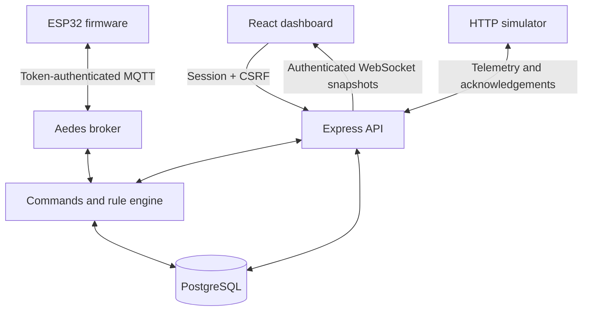

# Open IoT

**A self-hosted IoT workspace for devices, dashboards and everyday automation.**

Register devices, control virtual pins from your laptop or phone, build drag-and-drop dashboards, and automate outputs by time or sensor readings. Start without hardware using the included simulator, then connect an ESP32 over MQTT.

**Version 5.1.0 · MIT license · Node.js + React + PostgreSQL + MQTT**

This is a small-installation, trusted-LAN starter. It is not an audited internet-facing service, a safety controller, or an official Blynk/Sinric Pro integration.

## Features

| Area | Available now |
| --- | --- |
| Accounts | Registration, login, HttpOnly sessions, password changes, session revocation |
| Devices | Registration, online/offline status, rename, disable/delete, secure token reveal/rotation |
| Communication | Embedded Aedes MQTT broker, HTTP simulator, authenticated browser WebSockets |
| Virtual pins | V0–V31, add/edit/remove controls, typed inputs/outputs, bounds, telemetry history, command acknowledgements |
| Dashboard | Switches, sliders, gauges, values and charts; saved desktop/phone layouts |
| Automations | Once, daily or weekday schedules with timezones and run history |
| Rooms & groups | Named collections with device membership |
| Scenes | Up to 12 output actions from one manual button, with per-action results |
| Sensor rules | Above/below thresholds, reset margin, cooldown, pause and history |
| Manuals | Contextual “How to use” on every dashboard tab and a searchable full manual |

**Not implemented:** public Google/Alexa certification and proactive state reporting, mobile native app, OTA updates, email/password recovery, MFA, tenant sharing, Redis/TimescaleDB, high-availability deployment or a physical relay driver. The ESP32 sample controls an LED and publishes simulated temperature.

## Choose your installation

**Windows app users:** download the installer from [Releases](https://github.com/NITHIN9526/Open-IoT/releases). It bundles Node.js and PostgreSQL; Docker and the source setup below are not needed. Follow [Windows setup](docs/WINDOWS_INSTALLER.md).

**Source installation:** install Node.js 24 and Docker Desktop (or Docker Engine with Compose), open Docker, then run this single command in the downloaded/cloned project:

```sh
node scripts/setup-all.mjs
```

On Windows you can instead double-click **Setup-OpenIoT.cmd**. It checks Docker and application ports, creates `.env` only if missing, installs dependencies, starts PostgreSQL, repairs a local database password mismatch when needed, applies migrations, and starts the dashboard. Existing `.env`, encryption keys and database contents are retained. Internet is needed to download dependencies and the initial PostgreSQL image. Close any installed Open IoT service or other source instance first to avoid port conflicts.

After Vite is ready, open the displayed dashboard URL and create an account. Keep the window open. This prepares the server; ESP32 Wi-Fi credentials, firmware upload, LAN/firewall settings and Google/Alexa linking still need their own setup. The script does not install system prerequisites, modify the firewall, or delete data. To restart later without reinstalling dependencies, use the stop/restart instructions below.

## Quick start — no hardware needed

### Requirements

- Node.js **24** recommended (engine minimum **22.12**), with npm.
- Docker Desktop with Docker Compose, running. Linux users may use Docker Engine + Compose.
- Git, or download and extract this repository ZIP.
- Ports **5173** (web), **3000** (API), **5433** (PostgreSQL host mapping), and optionally **1883** (MQTT).

Open a terminal in the repository root—the folder containing `package.json`:

```sh
npm ci
npm run setup
docker compose up -d --wait postgres
npm run migrate
npm run dev
```

Run commands in order; stop and resolve any error before continuing. Setup creates a private `.env` with random credentials and **never overwrites an existing `.env`**. The database name `openiot_m1` and npm package name `open-iot-milestone-1` are retained for migration compatibility; this is the complete 5.1 release.

Open **http://localhost:5173**. Create an account, then:

1. Open **Devices → Add device** and choose **Laptop simulator**.
2. In the new-device token dialog, download **Simulator config**.
3. Save it as `.device.env` in the project root, beside `package.json`. Alternatively copy `.device.env.example` to `.device.env` and set the token.
4. In a second terminal in the same folder, run:

```sh
npm run simulate
```

5. Wait for **Online**, click the device name, and wait for **Live updates connected**.
6. Test **V1 ON/OFF** and **V2 brightness**. Wait for **Device confirmed**.

Keep both terminals running. The simulator reports dummy V0 temperature every two seconds. Register a separate device/token for each client; do not share a token between a simulator and a physical board.

### Stop and restart

Press Ctrl+C in the app/simulator terminals. Later, start Docker, then run:

```sh
docker compose up -d --wait postgres
npm run dev
```

Restart `npm run simulate` if needed. Keep the computer awake for automation. The browser can be closed. Do **not** use `docker compose down -v` unless you deliberately intend to erase the database volume.

## Connect an ESP32

The complete PlatformIO example is in [`firmware/esp32`](firmware/esp32/README.md). It targets the classic **ESP32 DevKit V1 / ESP32-WROOM**, using GPIO 2 for a demo LED.

1. Register an ESP32 in Devices and keep its UUID/token private.
2. In backend `.env`, set `MQTT_ENABLED=true`, `MQTT_HOST=0.0.0.0`, and `MQTT_PORT=1883`; restart the backend.
3. Allow TCP 1883 only on your trusted private LAN.
4. Copy `firmware/esp32/include/secrets.example.h` to `secrets.h`; enter Wi-Fi, laptop LAN IP, device UUID and token.
5. Open `firmware/esp32` in PlatformIO, build/upload, and open Serial Monitor at 115200 baud.

See the [firmware guide](firmware/esp32/README.md) for exact steps, pin mapping, logs and limitations. There is no need to install firmware when using only the simulator.

## Use it from your phone

Phone and laptop must be on the same trusted Wi-Fi.

1. Find your laptop IPv4 address (`ipconfig` on Windows).
2. Set `APP_ORIGIN=http://YOUR_LAPTOP_IP:5173` in `.env`, substituting the actual IP.
3. Restart `npm run dev`. Vite already listens on `0.0.0.0`; it proxies `/api` to the local backend.
4. Allow TCP 5173 on the Windows **Private** network profile, scoped to LocalSubnet.
5. Open that exact IP-based URL on **both laptop and phone**, then log in.

The default `HOST=127.0.0.1` can remain for the API because the browser uses the Vite proxy. MQTT has its separate binding. Do not expose PostgreSQL. See [configuration and LAN access](docs/CONFIGURATION.md) for firewall commands and port-conflict fixes.

## What to do in each tab

| Tab | Use it for | First example |
| --- | --- | --- |
| Devices | Device identity, connection and token management | Register an ESP32 or simulator |
| Device controls | Live readings and individual output commands | V1 ON, V2 40% |
| My dashboard | Arrange widgets across devices | Switch V1 + gauge V0 |
| Automations | Clock-based actions | V1 ON daily at 18:00, Asia/Kolkata |
| Rooms & groups | Organize device membership | Living room |
| Scenes | One-tap multi-output commands | V1 ON + V2 40 |
| Sensor rules | Respond to new threshold crossings | Above 25 → V1 ON |
| My account | Profile, password and browser sessions | Change password |
| Getting started | Searchable manual and troubleshooting | Search “cooldown” or “offline” |

Click **How to use** in the top bar for that page’s manual. Full offline instructions: [User manual](docs/USER_MANUAL.md).

A sensor rule is deliberately not “run immediately while true.” For **Above 25, reset margin 1**, it first needs a new reading at **24 or below**, then a reading **above 25**. See the manual before testing. The demo V0 is simulated.

## Architecture



Passwords use bcrypt; browser authentication uses HttpOnly session cookies with CSRF and exact-origin checks. Device tokens use SHA-256 lookup and AES-256-GCM recovery storage. Ownership is checked server-side. MQTT, rules and scheduling currently run in **one Node process**.

Read [architecture and protocol](docs/ARCHITECTURE.md) for SQL tables, MQTT topics, acknowledgement semantics and limits. Database migrations are in `sql/`; never edit an applied migration.

## Configuration and operating modes

- [Configuration](docs/CONFIGURATION.md): variables, LAN, ports and optional Docker app profile.
- [Operations](docs/OPERATIONS.md): backup/restore, restart, migration and troubleshooting.
- [Upgrade guide](UPGRADE.md): preserve existing milestone installations and secrets.
- [Security policy](SECURITY.md): supported scope and private reporting.

Default use is local development HTTP/plain MQTT. Public source on GitHub does **not** mean the running server should be publicly exposed. HTTPS/WSS, verified TLS for device traffic, trusted-proxy configuration, registration policy and further security/operational work are needed for an internet service.

## Development and testing

```sh
npm ci
npm test
npm run build
```

API tests use PGlite and do not need Docker. Browser checks use a disposable test database and simulator:

```sh
npx playwright install chromium --only-shell
npm run test:browser
```

On Linux CI, install browser OS libraries with `npx playwright install --with-deps chromium --only-shell`.

`npm run check:release` checks candidate repository files for private filenames, common credential patterns and local-machine references. It is a safeguard, not a guarantee that no secret exists; review staged changes yourself. CI runs release checks, automated tests, frontend build and browser checks. Firmware and Docker build jobs are also supplied; see [validation](docs/VALIDATION.md) for what was actually run locally.

## Repository map

| Path | Contents |
| --- | --- |
| `server/` | Auth, devices, MQTT, WebSockets, schedules, scenes and rules |
| `web/` | React/Vite/Tailwind UI and contextual manuals |
| `sql/` | Four ordered, checksummed PostgreSQL migrations |
| `scripts/` | Setup, migration, simulator and release checks |
| `firmware/esp32/` | PlatformIO LED demo, sample configuration |
| `tests/` | API, MQTT, migration and browser tests |
| `docs/` | User, configuration, architecture and operating guides |
| `.github/` | CI, dependency updates and issue/PR templates |

## Contribute or publish your fork

Read [CONTRIBUTING.md](CONTRIBUTING.md). Bug reports should include reproduction steps, versions and redacted logs—never credentials. For first publication, follow [the GitHub publishing guide](docs/PUBLISHING.md). GitHub Pages alone cannot run this backend, MQTT broker or PostgreSQL database.

## License

[MIT](LICENSE). Third-party dependencies retain their own licenses. This project is independent of Blynk and Sinric Pro and makes no affiliation claim.

## Optional Google Home and Alexa backend

The voice-control branch adds opt-in device mappings, OAuth account linking,
Google SYNC/QUERY/EXECUTE, and Alexa Discovery/PowerController/ReportState through
a small AWS Lambda adapter. It reuses the existing MQTT command/ACK flow.
Start with the **[step-by-step Google Assistant guide](docs/GOOGLE_ASSISTANT_SETUP.md)** for fresh installation, Google console fields, device mapping, phone linking, voice tests and troubleshooting.

See [the voice-control backend guide](docs/VOICE_CONTROL.md) for migration 005,
HTTPS tunnel setup, developer-console configuration, testing and current limits.
Voice is disabled by default. Public provider certification and proactive state
reporting are not included in this backend increment.

## Customize device controls

Open **Devices → your device**. Every pin card has **Edit** and **Remove** buttons, including the default Temperature, Power and Brightness cards. Use **Add virtual pin** for another channel; a Boolean Output gives you ON/OFF controls. The supported range is V0–V31.

- Edit the label or unit without losing state. Changing a pin number, type, direction or range requires a reset confirmation.
- Resetting clears reported state/readings, cancels pending commands, removes the affected dashboard widgets and removes the device voice mapping if it uses that pin. Renumbering/removing also removes that pin's command history.
- Schedules, scenes and sensor rules must first be edited or removed if they reference the pin, even when paused. The app identifies them instead of leaving stale actions connected to a new appliance.
- Removing a control does not turn off the hardware. Match ESP32 firmware to the new configuration; removed-pin telemetry is ignored, but wrong-type or output telemetry for an existing pin is still rejected.

The database schema is unchanged for this update. New devices retain the demo presets for compatibility; you can remove them individually. Existing firmware is not automatically rewritten. See **How to use → Device controls** for details.

## Windows installer candidate

A self-contained Windows server installer is being validated on this branch. It includes automatic service startup, local first-run setup, connection settings, and database backup/restore. See [Windows installation and operation](docs/WINDOWS_INSTALLER.md) for the candidate build, usage, and release limitations. Existing source/Docker installations are not imported automatically.
