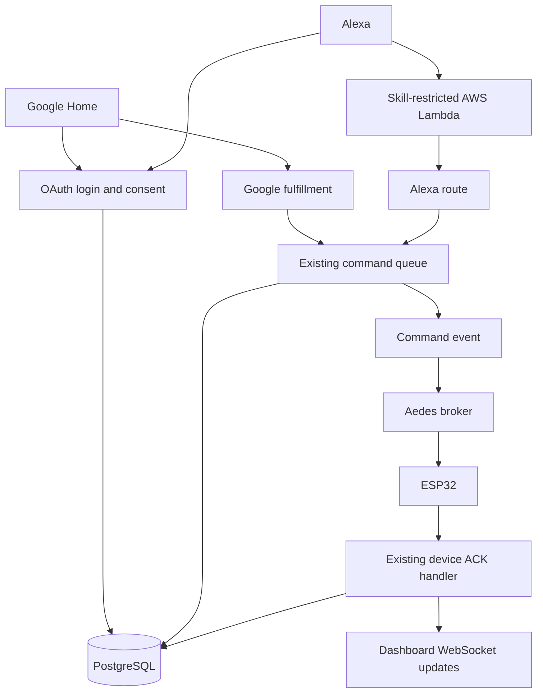

# Google Home and Alexa: optional voice backend

This branch extends GitHub Open IoT 5.1 (base commit `4358fb3`). It does not replace the dashboard, MQTT protocol, or firmware. This is a tested backend integration candidate for private developer testing, **not a certified, independently audited public service**. Real Google/Alexa account linking must still be tested with your own developer accounts.

For the complete Google-only walkthrough, start with [Connect to Google Home and Google Assistant](GOOGLE_ASSISTANT_SETUP.md). It includes Windows commands and recovery steps from account-linking testing.

## What is included

| File | Responsibility |
| --- | --- |
| `sql/005-voice-oauth.sql` | Clients, consent interactions, grants, hashed codes/access/refresh tokens, opt-in pin mappings, durable request deduplication |
| `server/routes/oauth.js` | Login/consent page and OAuth authorization-code / refresh exchanges |
| `server/routes/googleSmartHome.js` | SYNC, QUERY, EXECUTE, DISCONNECT |
| `server/routes/alexaSmartHome.js` | Discovery, PowerController TurnOn/TurnOff, ReportState, EndpointHealth |
| `server/voice/devices.js` | Existing command queue adapter, ACK wait, ownership and pin validation |
| `server/voice/install.js` | Route mounting and authenticated mapping/link-management API |
| `integrations/alexa/index.mjs` | Small AWS Lambda HTTPS forwarding adapter |
| `scripts/register-oauth-client.mjs` | Administrator-only client provisioning, random secret displayed once |
| `scripts/cleanup-oauth.mjs` | Expired OAuth-record cleanup |
| `tests/voice.test.js` | OAuth and protocol integration regression test |

Google maps boolean output V1 to OnOff and optional numeric output V2 (exact range 0–100) to Brightness. The mapping API permits other V0–V31 pins with compatible metadata. Alexa exposes power control and power-state reporting only in this increment. Temperature V0 remains a dashboard input. No microphone/audio data is processed by Open IoT.



## Why EXECUTE does not directly overwrite a pin

`device_commands.value` is the requested state. `device_pins.value` is the last **acknowledged** state. The adapter calls the existing `enqueueCommand()` inside a PostgreSQL transaction; after commit it emits `events.emit('command', deviceId)`. The existing MQTT service publishes the normal `iot/<device UUID>/down` packet. The ESP32 ACK updates the pin through existing core logic.

Voice waits up to approximately 3.5 seconds for ACK, with a shortened command expiry. A missing ACK produces an unreachable/error response and expires the pending command. A device may have physically applied a command whose ACK was lost; an error cannot undo a physical action. No false success, retained MQTT commands, or offline replay is introduced. Multi-device requests have independent outcomes; combined power/brightness is not a hardware transaction.

Repeated request IDs are deduplicated per OAuth grant and device, even after command-history cleanup. Changed values under the same request ID are rejected. Different request IDs requesting the same absolute state are safe to execute again. Only one pending command per pin is allowed, matching the dashboard.

## 1. Apply and prepare

Work in the GitHub project folder, not the older milestone folder. Save/commit any local source changes first. The patch does not contain secrets, dependencies, or database files and does not change migrations 001–004.

```powershell
cd "$env:USERPROFILE\Downloads\Open_IoT_GitHub_5_1\open-iot"
git switch main
git pull --ff-only
git switch -c feature/voice-control
git apply --check "$env:USERPROFILE\Downloads\Open_IoT_Voice.patch"
git apply "$env:USERPROFILE\Downloads\Open_IoT_Voice.patch"
npm ci
docker compose up -d --wait postgres
npm run migrate
npm test
npm run build
```

If `git apply --check` reports a conflict, stop and resolve it against current main; do not overwrite your project with an old ZIP. For a completely fresh clone run `npm run setup` before starting PostgreSQL, and follow the main README. Voice does not reset an existing database.

Create an Open IoT account and device using the normal dashboard. Flash/configure your existing ESP32 firmware or use `npm run simulate`. Enable voice mappings as described below before account linking.

## 2. HTTPS tunnel

Use the **built Express app on port 3000**, not Vite on 5173. OAuth form posts, browser sessions and dashboard requests must use the same public origin. Keep PostgreSQL private; the HTTP tunnel does not expose MQTT. ESP32 continues connecting to the laptop's LAN MQTT address.

### Cloudflare quick tunnel (temporary test)

Install cloudflared on Windows using the official installation instructions (or `winget install --id Cloudflare.cloudflared`). Run:

```powershell
cloudflared tunnel --url http://127.0.0.1:3000
```

Copy the printed `https://...trycloudflare.com` origin. A quick tunnel URL changes on restart; update your `.env`, both consoles, and Lambda URL when that happens. For persistent use configure a named Cloudflare Tunnel with a domain you own. Quick tunnels are for development, with no availability guarantee.

### ngrok alternative

Install the ngrok agent, create an account, then:

```powershell
ngrok config add-authtoken YOUR_NGROK_AUTHTOKEN
ngrok http 3000
```

Use the printed HTTPS forwarding origin. If ngrok displays an interstitial or rejects provider callbacks on your plan/domain, use a configured domain or Cloudflare instead. Do not put an interactive authentication challenge in front of the OAuth/token/fulfillment routes.

### Express configuration

Generate a separate Lambda bridge secret:

```powershell
node -e "console.log(require('node:crypto').randomBytes(32).toString('base64url'))"
```

Edit your existing `.env` (keep its database and token-encryption settings):

```dotenv
VOICE_ENABLED=true
APP_ORIGIN=https://YOUR-TUNNEL-HOST
NODE_ENV=production
HOST=127.0.0.1
PORT=3000
TRUST_PROXY=loopback
ALEXA_BRIDGE_SECRET=PASTE_THE_GENERATED_RANDOM_VALUE
MQTT_ENABLED=true
MQTT_HOST=0.0.0.0
MQTT_PORT=1883
```

`TRUST_PROXY=loopback` assumes cloudflared/ngrok is running on the same host. Configure explicit trusted proxy networks for any other topology; never blindly trust arbitrary forwarded headers. Restrict inbound MQTT to your trusted LAN. The current firmware/MQTT example is plaintext and is not an internet-facing MQTT deployment.

```powershell
npm run build
npm start
```

Open the **HTTPS tunnel URL** and log in. Use this URL for the dashboard during voice testing. Secure cookies intentionally do not work at a plain HTTP LAN URL in production mode. The tunnel publicly exposes the HTTP application; use a test instance and protect account registration/administration appropriately for a public service. Stop the tunnel when testing ends.

## 3. Opt a device into voice control

There is no new dashboard tab in this backend-only increment. From your signed-in dashboard, open browser Developer Tools → Console and execute the following **reviewed, same-origin** snippet, replacing the device UUID:

```js
const me = await fetch('/api/auth/me').then(r => r.json());
const response = await fetch('/api/voice/devices/YOUR-DEVICE-UUID', {
  method: 'PUT',
  headers: {'Content-Type':'application/json', 'X-CSRF-Token':me.csrfToken},
  body: JSON.stringify({powerPin:'V1', brightnessPin:'V2'})
});
console.log(response.status, await response.json());
```

For a switch without brightness use `brightnessPin:null`. Input pins and numeric power pins are rejected. Ownership, existing browser CSRF checks, and metadata validation apply. Nothing is exposed automatically just because it has V1/V2. Rotating a device token requires saving the voice mapping again after firmware credentials are updated.

Before testing queries, set power and brightness once in the normal dashboard and wait for acknowledgements. Firmware boot alone does not establish confirmed output state. Google QUERY returns an error when a required mapped state is unknown; Alexa ReportState needs a confirmed power value. Reported state describes the last ACK, not physical electrical feedback. An online heartbeat after a reboot does not prove the prior output survived that reboot; production firmware needs boot state reconciliation.

## 4. Google Home developer setup

New Cloud-to-cloud integrations are configured in the **Google Home Developer Console**, not the retired conversational Actions workflow.

1. Open <https://console.home.google.com/> with the account used in your Google Home app.
2. Create/select a developer project. Record its project ID.
3. Add a **Cloud-to-cloud integration**, choose a name such as Open IoT, device type Light/Switch as appropriate, and complete the required branding fields.
4. Register a local confidential OAuth client (replace PROJECT_ID literally):

```powershell
node --env-file=.env scripts/register-oauth-client.mjs google openiot-google "https://oauth-redirect.googleusercontent.com/r/PROJECT_ID" "https://oauth-redirect-sandbox.googleusercontent.com/r/PROJECT_ID"
```

Save the displayed secret privately. The database stores only its SHA-256 hash. A duplicate client ID is rejected rather than silently rotating a live secret.

5. Configure account linking with OAuth **authorization code**:

| Setting | Value |
| --- | --- |
| Client ID | `openiot-google` |
| Client secret | The generated secret |
| Authorization URL | `https://YOUR-TUNNEL-HOST/oauth/authorize` |
| Token URL | `https://YOUR-TUNNEL-HOST/oauth/token` |
| Scope | `devices:control` |
| Cloud fulfillment URL | `https://YOUR-TUNNEL-HOST/voice/google` |

Client credentials in the POST body (Google default) and HTTP Basic are both supported. Configure only one method per request. Exact registered redirect matching is enforced; there are no wildcard redirects.

6. Save the integration, enable its developer testing flow, then in Google Home choose Add / Works with Google Home and find your test integration (often prefixed `[test]`). Console/app labels can vary by release and account eligibility.
7. Sign in on the Open IoT consent page and choose **Agree and link**. This is your Open IoT password, not your Google password.
8. Test “turn on Desk lamp”, “turn off Desk lamp”, and “set Desk lamp brightness to 40 percent”. Use your device's actual name.
9. Test offline behavior by stopping the simulator/disconnecting the ESP32 and waiting more than 30 seconds. It should report unreachable, not success.
10. Run the Google Home Test Suite before considering publication. Removing the link sends DISCONNECT; the code revokes only that link grant so other linked users remain independent.

`willReportState:false` is deliberate. This increment does not implement Home Graph Report State, Request Sync, or `agentUsers.delete`. After changing discovery mappings/names, request device sync/relink for development. Add these lifecycle features and review current Google policies before public launch; do not set `willReportState:true` without implementing reports.

## 5. Alexa developer setup

Alexa Smart Home uses an **AWS Lambda ARN** as its service endpoint. Do not paste the Express URL into the Lambda ARN field. The included Lambda forwards authenticated Alexa events to Express; Express still validates the account-linked OAuth access token and provider.

1. Open <https://developer.amazon.com/alexa/console/ask>. Create a Smart Home skill/add-on using the Smart Home model (current documentation may call these add-ons). Select your supported language/marketplace and copy the skill ID.
2. Create a Node.js Lambda in the AWS region supported for that Alexa marketplace. Follow Amazon's region table; for example, North American English testing commonly uses us-east-1. Do not assume an arbitrary region works for every locale.
3. Copy `integrations/alexa/index.mjs` into Lambda's `index.mjs`, set handler `index.handler`, timeout 8 seconds, and deploy. Use a currently supported Node.js runtime with global fetch.
4. Add an **Alexa Smart Home** trigger. Enable skill-ID verification and restrict it to the exact skill ID. Do not enable a public Lambda Function URL.
5. Add these Lambda environment variables (use a secret manager for a managed production deployment):

```dotenv
OPENIOT_ALEXA_URL=https://YOUR-TUNNEL-HOST/voice/alexa
OPENIOT_BRIDGE_SECRET=THE_SAME_RANDOM_VALUE_AS_ALEXA_BRIDGE_SECRET
```

6. Copy Lambda's ARN to your skill's Smart Home service endpoint for the corresponding region.
7. Open **Account Linking**, enable authorization-code account linking and copy **all redirect URLs shown by your console**. Register them exactly:

```powershell
node --env-file=.env scripts/register-oauth-client.mjs alexa openiot-alexa "EXACT_HTTPS_REDIRECT_1" "EXACT_HTTPS_REDIRECT_2" "EXACT_HTTPS_REDIRECT_3"
```

Omit unused redirect arguments; do not paste the example names verbatim. Amazon redirect domains and vendor IDs vary by marketplace.

8. Configure:

| Setting | Value |
| --- | --- |
| Authorization URI | `https://YOUR-TUNNEL-HOST/oauth/authorize` |
| Access Token URI | `https://YOUR-TUNNEL-HOST/oauth/token` |
| Client ID / secret | `openiot-alexa` / its generated secret |
| Grant | Authorization code |
| Scope | `devices:control` |
| Client authentication | HTTP Basic (request-body credentials also supported) |
| PKCE, if offered | S256 supported |

9. **Leave Send Alexa Events/proactive event permission disabled for this increment.** Discovery advertises `proactivelyReported:false`. AcceptGrant/Event Gateway is not implemented. If a chosen console flow requires that permission or issues AcceptGrant anyway, implement the event-grant flow before proceeding; do not return fake AcceptGrant success.
10. Enable development testing and enable your skill/add-on in Alexa using the same developer Amazon account. Complete Open IoT account linking and discover devices.
11. Test “Alexa, turn on Desk lamp” and “Alexa, turn off Desk lamp”. Test ReportState through Alexa's developer testing tools. Brightness is currently Google-only; Alexa does not advertise a brightness capability it cannot fully handle.

The bridge secret authenticates the Lambda-to-Express hop. The Lambda's **skill-restricted AWS trigger** authenticates the Alexa-to-Lambda hop. OAuth access tokens authorize the user/device scope. These are three separate controls. Never use a device firmware token for account linking, or log complete directives containing access tokens.

## 6. OAuth and linked-account operations

Tokens are opaque, cryptographically random 32-byte base64url strings, stored as SHA-256 hashes. Hashing is appropriate for high-entropy random credentials; passwords continue using bcrypt. No reversible access-token storage is needed.

- Consent interactions: 10 minutes, bound to an HttpOnly SameSite=Lax browser cookie; form POST requires exact Origin.
- Authorization codes: 5 minutes, single-use transactional redemption, bound to grant/client/redirect and optional S256 PKCE.
- Access tokens: 1 hour; Google tokens cannot call Alexa or vice versa.
- Refresh tokens: fixed 90-day lifetime, client-authenticated and **not rotated on refresh** for provider compatibility and concurrent refresh tolerance. Expiration requires relinking. This does not provide refresh-token replay detection; select an explicit rotation/grace policy if provider validation permits it for your production requirements.
- Each account link has its own grant. A password change revokes every voice grant via an additive database trigger; account deletion cascades credentials. Ordinary browser logout does not unlink voice accounts.
- Token checks include grant revocation and client enabled state. Unknown bearer tokens fail closed. Cookies do not authorize cloud fulfillment.
- A command already delivered before unlinking may finish; unlink does not physically undo in-flight actions.

List and revoke links from the signed-in dashboard console:

```js
const links = await fetch('/api/voice/grants').then(r => r.json());
console.table(links.grants);
const me = await fetch('/api/auth/me').then(r => r.json());
await fetch('/api/voice/grants/LINK-GRANT-UUID', {
  method:'DELETE',
  headers:{'Content-Type':'application/json','X-CSRF-Token':me.csrfToken},
  body:'{}'
});
```

For Google, also unlink in the Google Home app; local revocation alone does not remove its Home Graph record. Disable a device mapping using `DELETE /api/voice/devices/<device UUID>` with the same session/CSRF headers and `{}` body. Re-discover/relink to remove a cached endpoint from an assistant app.

Run this cleanup daily with a scheduled task from the project directory:

```powershell
node --env-file=.env scripts/cleanup-oauth.mjs
```

Voice-request deduplication tombstones are retained for the lifetime of each grant; pruning them while a grant is valid would permit old request IDs to execute again.

## 7. Security, scaling and publication boundaries

The module reuses the existing single-process Aedes/event architecture. It is not a horizontally scaled broker cluster: local `events.emit` requires voice HTTP handlers and MQTT connections in the same Node process. For multiple replicas, publish durable command-outbox events through a shared bus and broker topology, and add a shared rate-limit store. Do not add replicas and assume local EventEmitter events propagate.

Before exposing a public multi-user service: review OAuth implementation independently, add tenant-aware quotas and audit/metrics, distributed rate limiting if applicable, managed secrets, fixed TLS domain, privacy/deletion policies, account abuse protection, backups, production monitoring and provider certification. Restrict proxy access and redact OAuth headers, passwords, codes and query strings from access logs. Use TLS or a private VPN for remote MQTT devices. SQL connections and pool timeouts can exceed the application ACK budget under overload; tune and load-test ingress/DB deadlines for provider response SLAs.

Alexa proactive ChangeReport/AcceptGrant, Google Home Graph reports/request-sync/unlink notification, firmware boot-state reconciliation, device selection UI, and cloud end-to-end certification are intentionally not claimed complete. No existing frontend tabs or manuals are silently repurposed. The README links this backend guide; a user-facing Integrations tab is a separate follow-up.

## Troubleshooting

- **invalid_request on consent:** use the public HTTPS APP_ORIGIN exactly, reopen linking after a tunnel change, and verify exact redirect allowlists. Duplicate linking tabs replace the browser binding cookie; finish one at a time.
- **access_denied:** use your Open IoT credentials. Restart the linking flow after a password change.
- **invalid_client:** check client ID, secret, and Basic-vs-body setting. Never send both methods together.
- **No devices discovered:** save a voice mapping, verify ownership and pin types, and resave after device-token rotation.
- **Unreachable although connected:** confirm ACKs in the normal dashboard; initialize output states; check MQTT_ENABLED, firmware token and LAN broker host. HTTP health alone does not prove MQTT delivery.
- **Invalid Alexa credential:** use Alexa's OAuth client, not Google's, and ensure the Lambda bridge secret matches.
- **Alexa endpoint rejects URL:** its console needs the Lambda ARN; the HTTPS URL belongs in Lambda's OPENIOT_ALEXA_URL setting.
- **Local HTTP dashboard stops logging in:** production cookies require the HTTPS tunnel origin. Restore your original development .env settings when ending the test.

## Official references (checked 2026-10-11)

- Google setup: https://developers.home.google.com/cloud-to-cloud/integration/create
- Google OAuth: https://developers.home.google.com/cloud-to-cloud/project/authorization
- Google EXECUTE: https://developers.home.google.com/cloud-to-cloud/intents/execute
- Alexa setup: https://developer.amazon.com/docs/alexaplus/smarthome/steps-to-build-addons.html
- Alexa account linking: https://developer.amazon.com/docs/alexaplus/account-linking/steps-to-implement-account-linking.html
- Alexa Discovery: https://developer.amazon.com/docs/alexaplus/device-apis/alexa-discovery.html
- Alexa PowerController: https://developer.amazon.com/docs/alexaplus/device-apis/alexa-powercontroller.html
- Cloudflare quick tunnels: https://developers.cloudflare.com/tunnel/get-started/quick-tunnels/
- ngrok: https://ngrok.com/docs/start
